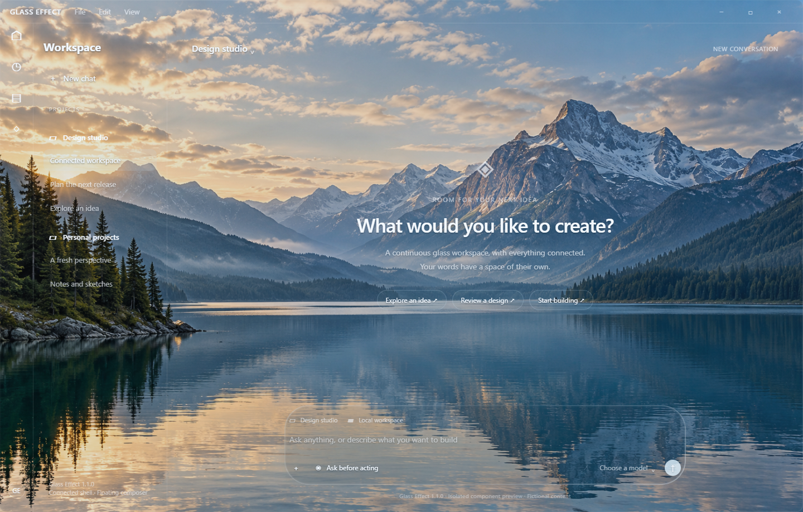
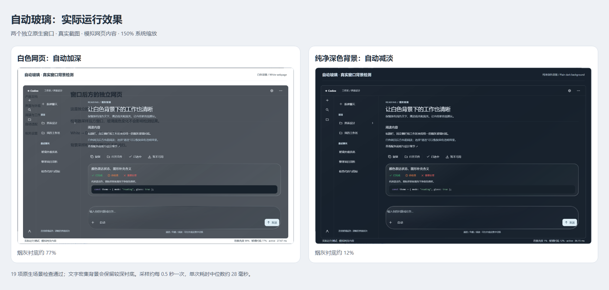

# Glass Effect

**Clear desktop glass for the OpenAI Codex desktop app on Windows.**

Glass Effect gives Codex a continuous transparent desktop window with thin
illuminated edges. The title bar, navigation rail, docked sidebar, and workspace
connect without gaps and share one glass background. The composer remains
an independent floating surface. The desktop and other windows remain visible
behind the app; an optional alpine lake scene provides an alternative background.

This is a standalone project with its own repository, installer, shortcuts,
application directory, and appearance profile. It is independent of the
earlier Frosted Glass / Codex Liquid Glass project.



*Connected workspace in an isolated component preview with fictional content
and the included alpine lake scene.*

## Adaptive reading in 1.2.0

White webpages now automatically deepen the smoky glass base. Clean dark
backgrounds let it clear again. Open **Settings > Appearance > Glass reading
mode** and choose **Auto**, **Clear**, **Balanced**, or **Reading**.
Auto is the new default; existing appearance values are retained. Once you
choose a manual mode, that choice is saved across restarts.



[Watch the native-window test video](https://github.com/yhc904444-eng/glass-effect/releases/download/v1.2.0/Glass-Effect-1.2.0-Native-Test.mp4).
The comparison and video show the local Chinese CodexGlass prototype, two
separate native windows, and fictional webpage content at 150% display scaling.
The release uses the same adaptive engine with English controls and the later
slider fix. See [detection behavior and privacy](docs/adaptive-background.md).

## Appearance

- **Clear desktop:** native window transparency reveals the live desktop.
- **Alpine lake:** switch to the included mountain-and-lake scene.
- **Connected shell:** the title bar, navigation rail, docked sidebar, and
  workspace meet seamlessly, including both docked sidebar corners.
- **Synchronized body transparency:** one control adjusts all permanent panes
  together. The composer, peeking sidebar, and popups keep separate controls.
- **Fine edge controls:** adjust tint, highlights, edge blur, width,
  intensity, and animation speed; turn animated edges off at any time.
- **Consistent settings:** glass styling includes native select shells,
  buttons, and input wrappers while retaining focus and disabled states.
- **Immediate adjustments:** controls apply changes immediately and save
  preferences locally. Reduced-motion preferences are respected.

Clear desktop mode uses native transparency. In Auto mode, a separate local
helper samples windows behind the app to adjust its tint. It processes pixels
in memory and returns color/brightness statistics; it does not save or upload
images. Manual modes stop sampling. Decorative edge optics operate within
the application; their blur setting does not blur the desktop outside it.

## Download and install

Download [Glass Effect 1.2.0](https://github.com/yhc904444-eng/glass-effect/releases/tag/v1.2.0).

1. Use **Windows 11 22H2 or newer, x64**, with approximately **5 GB** of free
   space and a compatible official Codex installation (see below).
2. Open **Glass-Effect-1.2.0-Setup.exe**. Setup runs for your Windows account
   and builds a separate local copy. No development tools are required.
3. Open **Glass Effect** from the desktop or Start menu. Sign in if prompted,
   then open **Settings > Appearance** to adjust the material.

Alternatively, extract **Glass-Effect-1.2.0-Installer.zip** and double-click
**Install.cmd**. The EXE and ZIP contain the same installation scripts and
customization source. They do not contain the official Codex application.

The community installer is unsigned. Windows SmartScreen or organization
policies may require confirmation or prevent installation. Internet access
and an account with Codex access are required for normal sign-in and use.

If Codex is missing, setup can download its official Windows package from
OpenAI and verify its publisher signature. That download retrieves the latest
official version, which may be newer than this customization supports.
Installation stops if the compatibility check fails.

## Compatibility

| Official Store package | Application version | Architecture |
| --- | --- | --- |
| 26.1016.8622.0 | 26.1016.62342 | Windows x64 |

Version 1.2.0 targets this specific application build. It checks the original
archive SHA256, the executable integrity metadata, and both native integration
points before patching its isolated copy. Newer Codex builds are not currently
supported; do not downgrade a working official installation to force a match.

The official application keeps its normal update behavior. The customized
copy remains on the compatible version used during installation. Future
official versions may require a new Glass Effect release.

## Separate installation and local data

| Item | Default location |
| --- | --- |
| Application | `%LOCALAPPDATA%\Programs\GlassEffect` |
| Isolated browser profile | `%APPDATA%\GlassEffect` |
| Appearance preferences | `%APPDATA%\GlassEffect\liquid-glass.json` |
| Shortcut | `Glass Effect` |

No earlier glass installation or browser profile is copied or replaced.
Appearance preferences start in this project's separate profile. Normal Codex
account configuration and workspace access follow the official client's
behavior and may use shared account configuration outside that profile.

To uninstall, fully exit Glass Effect and use **Windows Settings > Apps >
Installed apps**, or run **Uninstall.ps1** from its installation directory.
Uninstall keeps the isolated profile and appearance preferences. Updating
requires uninstalling the old application copy before installing a compatible
new release.

When upgrading from 1.0.0 or 1.1.0, fully exit Glass Effect, uninstall its old application
copy, then install 1.2.0. The existing profile and saved preference keys are kept.
**Body transparency** uses the former workspace value for all permanent panes.
**Floating sidebar transparency** uses the saved sidebar value only when that
sidebar appears as a floating panel. The composer value stays independent.

The customized executable's archive-integrity metadata is updated to match
the customized archive. Archive-integrity verification stays enabled; the
modified executable no longer carries a valid original Authenticode signature.
Normal launch does not enable a debugging port.

## Build from source

The customization has no npm dependencies. Contributors need Node.js 18+,
Windows PowerShell, and the Windows .NET Framework compiler.

```powershell
powershell.exe -NoProfile -ExecutionPolicy Bypass -File .\native\Build.ps1
node --test tests/*.test.cjs
powershell.exe -NoProfile -ExecutionPolicy Bypass -File .\Build.ps1
```

The installer uses the runtime bundled with the compatible official client.
`Build.ps1` creates the EXE, installer ZIP, and SHA256 checksums from an
explicit file list. It excludes application binaries, profiles, credentials,
conversations, logs, and local verification output.

For an isolated installation check using a compatible official source:

```powershell
.\Install.ps1 -SourceAppPath 'C:\path\to\official\app' `
  -InstallRoot 'D:\temporary-test\GlassEffect' -NoShortcut -NoLaunch
```

See [VALIDATION.md](VALIDATION.md) for verification scope and limitations.

## License

Customization source is licensed under MIT. OpenAI software and trademarks
retain their own terms. This independent community project is not affiliated
with or endorsed by OpenAI or Microsoft. See
[THIRD_PARTY_NOTICES.md](THIRD_PARTY_NOTICES.md).
