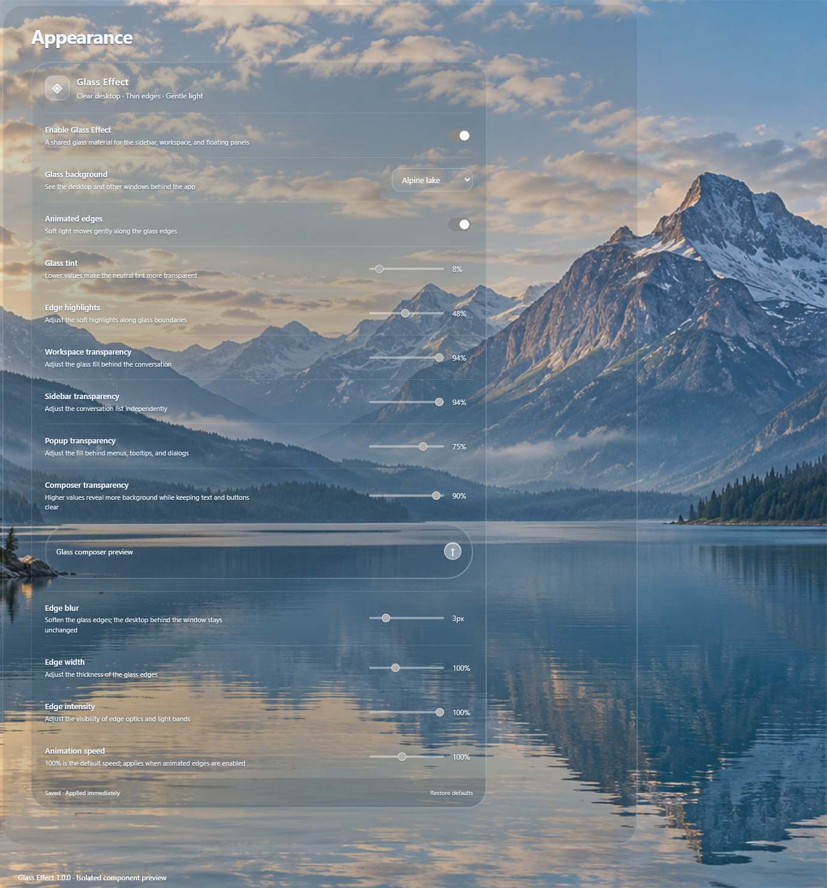

# Glass Effect

**Clear desktop glass for the OpenAI Codex desktop app on Windows.**

Glass Effect gives Codex a transparent desktop window, thin illuminated edges,
and a consistent glass material across the workspace, sidebar, composer,
settings controls, menus, tooltips, and dialogs. The desktop and other windows
remain visible behind the app. An optional alpine lake scene provides a
calm alternative background.

This is a standalone project with its own repository, installer, shortcuts,
application directory, and appearance profile. It is independent of the
earlier Frosted Glass / Codex Liquid Glass project.



*English appearance controls in an isolated component preview, using the
included alpine lake scene.*

## Appearance

- **Clear desktop:** native window transparency reveals the live desktop.
- **Alpine lake:** switch to the included mountain-and-lake scene.
- **Independent transparency:** adjust the workspace, sidebar, composer,
  and floating panels separately.
- **Fine edge controls:** adjust tint, highlights, edge blur, width,
  intensity, and animation speed; turn animated edges off at any time.
- **Consistent settings:** glass styling includes native select shells,
  buttons, and input wrappers while retaining focus and disabled states.
- **Immediate adjustments:** controls apply changes immediately and save
  preferences locally. Reduced-motion preferences are respected.

The clear desktop mode uses native transparency. It does not capture the
screen or bend desktop pixels. Decorative edge optics operate within the
application; their blur setting does not blur the desktop outside it.

## Download and install

Download [Glass Effect 1.0.0](https://github.com/yhc904444-eng/glass-effect/releases/tag/v1.0.0).

1. Use **Windows 11 22H2 or newer, x64**, with approximately **5 GB** of free
   space and a compatible official Codex installation (see below).
2. Open **Glass-Effect-1.0.0-Setup.exe**. Setup runs for your Windows account
   and builds a separate local copy. No development tools are required.
3. Open **Glass Effect** from the desktop or Start menu. Sign in if prompted,
   then open **Settings > Appearance** to adjust the material.

Alternatively, extract **Glass-Effect-1.0.0-Installer.zip** and double-click
**Install.cmd**. The EXE and ZIP contain the same installation scripts and
customization source. They do not contain the official Codex application.

The community installer is unsigned. Windows SmartScreen or organization
policies may require confirmation or prevent installation. Internet access
and an account with Codex access are required for normal sign-in and use.

If Codex is missing, setup can download its official Windows package from
OpenAI and verify its publisher signature. That download retrieves the latest
official version, which may be newer than this customization supports.
Installation stops if the compatibility check fails.

## Compatibility

| Official Store package | Application version | Architecture |
| --- | --- | --- |
| 26.1016.8622.0 | 26.1016.62342 | Windows x64 |

Version 1.0.0 targets this specific application build. It checks the original
archive SHA256, the executable integrity metadata, and both native integration
points before patching its isolated copy. Newer Codex builds are not currently
supported; do not downgrade a working official installation to force a match.

The official application keeps its normal update behavior. The customized
copy remains on the compatible version used during installation. Future
official versions may require a new Glass Effect release.

## Separate installation and local data

| Item | Default location |
| --- | --- |
| Application | `%LOCALAPPDATA%\Programs\GlassEffect` |
| Isolated browser profile | `%APPDATA%\GlassEffect` |
| Appearance preferences | `%APPDATA%\GlassEffect\liquid-glass.json` |
| Shortcut | `Glass Effect` |

No earlier glass installation or browser profile is copied or replaced.
Appearance preferences start in this project's separate profile. Normal Codex
account configuration and workspace access follow the official client's
behavior and may use shared account configuration outside that profile.

To uninstall, fully exit Glass Effect and use **Windows Settings > Apps >
Installed apps**, or run **Uninstall.ps1** from its installation directory.
Uninstall keeps the isolated profile and appearance preferences. Updating
requires uninstalling the old application copy before installing a compatible
new release.

The customized executable's archive-integrity metadata is updated to match
the customized archive. Archive-integrity verification stays enabled; the
modified executable no longer carries a valid original Authenticode signature.
Normal launch does not enable a debugging port.

## Build from source

The customization has no npm dependencies. Contributors need Node.js 18+,
Windows PowerShell, and the Windows .NET Framework compiler.

```powershell
node --test tests/patch.test.cjs
powershell.exe -NoProfile -ExecutionPolicy Bypass -File .\Build.ps1
```

The installer uses the runtime bundled with the compatible official client.
`Build.ps1` creates the EXE, installer ZIP, and SHA256 checksums from an
explicit file list. It excludes application binaries, profiles, credentials,
conversations, logs, and local verification output.

For an isolated installation check using a compatible official source:

```powershell
.\Install.ps1 -SourceAppPath 'C:\path\to\official\app' `
  -InstallRoot 'D:\temporary-test\GlassEffect' -NoShortcut -NoLaunch
```

See [VALIDATION.md](VALIDATION.md) for verification scope and limitations.

## License

Customization source is licensed under MIT. OpenAI software and trademarks
retain their own terms. This independent community project is not affiliated
with or endorsed by OpenAI or Microsoft. See
[THIRD_PARTY_NOTICES.md](THIRD_PARTY_NOTICES.md).
