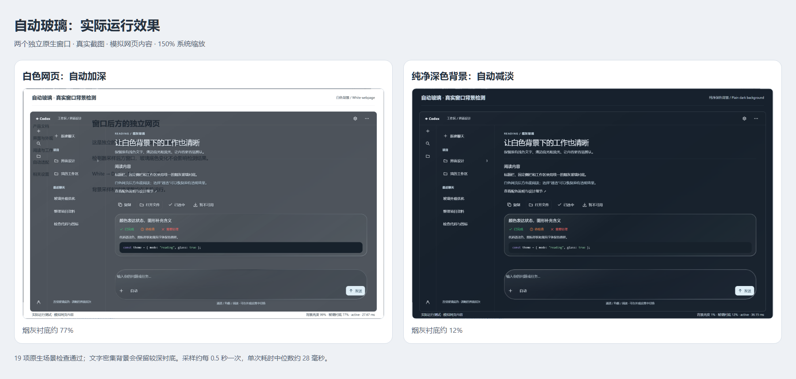

# Adaptive background glass

Choose **Settings > Appearance > Glass reading mode > Auto**. A white or
bright background deepens the smoky glass base; a stable, clean dark background
lets it clear. Bright details such as text on a dark webpage can keep a deeper
base. Body, tint, composer, popup, and floating sidebar sliders still affect
their surfaces in Auto, Balanced, and Reading modes.

Auto becomes the default when old preferences are first loaded. Other existing
appearance values remain intact. The migration itself does not rewrite the
preference file. A later explicit mode or slider change saves the normalized
settings, including the migration marker. Manual mode choices survive restarts.

## Detection

The helper enumerates visible windows behind the glass window in z order and
excludes all windows belonging to the client. It calls Windows PrintWindow on
eligible background windows and samples 640 points with nearby detail checks.
It returns brightness, color, bright-area, and detail statistics to the client.
The actual desktop view continues to use native transparent window composition.

Samples run serially, with approximately 500 ms between completed cycles.
Darkening reacts quickly; clearing waits for stable input and changes smoothly.
The controller computes a tint for a modeled 4.8:1 text contrast target. This
sampled model is not a guarantee for every pixel, element, or third-party window.
Manual sliders can add more tint. No geometry or hit-testing changes are made
by the adaptive controller.

Hidden or minimized windows pause sampling. Clear, Balanced, and Reading modes
stop the helper. The alpine scene uses a static reading base. Capture failures,
timeouts, or unavailable windows fall back to a reading base. The helper runs
separately with a timeout/watchdog; a blocked capture does not block the UI.

## Privacy and limitations

The production helper processes pixels in memory, releases its buffers, and
emits only statistics. It does not write screenshots, record video, or send
network requests. Normal screenshots and screen recording can still show the
glass window. The demonstration recorder is a separate local QA tool and is
not included in this release.

Protected, hung, minimized, cloaked, or capture-incompatible background windows
cannot always be detected. An ambiguous all-black capture is treated as
unavailable. Certain GPU/video surfaces and the bare desktop may use the
reading fallback. The tests cover local simulated windows at 150% scaling,
not all displays or applications.

PrintWindow reference: [Microsoft documentation](https://learn.microsoft.com/en-us/windows/win32/api/winuser/nf-winuser-printwindow).

## Visual evidence

[Native-window test video](https://github.com/yhc904444-eng/glass-effect/releases/download/v1.2.0/Glass-Effect-1.2.0-Native-Test.mp4)

These are real captures of two separate native windows using fictional
webpage content in the local Chinese CodexGlass prototype. The video is an
approximately 40-second edited excerpt of the original recording. It is
evidence of the adaptive engine; the 1.2.0 release has English controls and
also includes the subsequent slider responsiveness fix. It is not footage of
an authenticated user session or a claim that every client page was tested.
